# La raíz que se esconde — Comparación de métodos de búsqueda de raíces

## Objetivo

Implementar y comparar seis métodos de búsqueda de raíces sobre funciones de distinta naturaleza, y mostrar con datos y gráficos en qué se diferencian al converger:

- Métodos cerrados: **bisección** y **falsa posición**.
- Métodos abiertos: **punto fijo**, **secante**, **Newton-Raphson** y **Newton-Raphson modificado**.
- Funciones: polinómica, logarítmica, exponencial, trigonométrica, mixta y una con **raíz doble** que toca el eje x sin cruzarlo.
- Se registra para cada método: iteraciones, raíz encontrada y error.

> **Nota sobre el criterio de parada:** se usa `|f(x)| < tol` o `|x − x₋₁| < tol`, con `tol = 1e-6` y un tope de `100` iteraciones (`TOLERANCIA` y `MAX_ITER` en el código).

## Ambiente controlado

| # | Categoría | f(x) | Intervalo [a, b] | x₀ | x₁ (secante) | f(a)·f(b) | ¿Cambio de signo? |
|---|---|---|---|---|---|---|---|
| 1 | Polinómica | x³ − x − 2 | [1, 2] | 1.5 | 2.0 | −8.0000 | Sí |
| 2 | Raíz doble | (x − 2)² | [1, 3] (solo gráfico) | 1.2 | 1.5 | 1.0000 | **No** (tangencia en x = 2) |
| 3 | Logarítmica | ln(x) + x − 4 | [2, 3] | 2.5 | 3.0 | −0.1289 | Sí |
| 4 | Exponencial | e⁻ˣ − x | [0, 1] | 0.5 | 1.0 | −0.6321 | Sí |
| 5 | Trigonométrica | cos(x) − x | [0, 1] | 0.5 | 1.0 | −0.4597 | Sí |
| 6 | Mixta | √x − cos(x) | [0.1, 1] | 0.5 | 1.0 | −0.3120 | Sí |

- En las funciones 1, 3, 4, 5 y 6 se cumple f(a) x f(b) < 0, por lo que, por el **teorema de Bolzano**, existe al menos una raíz en [a, b].
- En la función 2 se cumple `f(2) = 0` y `f'(2) = 0`: la curva **toca** el eje x sin cruzarlo, por lo que no hay cambio de signo aunque sí hay raíz.

Gráficos de cada función con su raíz marcada:

### Funciones de punto fijo g(x)

Para punto fijo se despeja x de f(x) = 0 y se itera x = g(x). Converge si |g'(x)| < 1 cerca de la raíz.

| # | g(x) | Despeje |
|---|---|---|
| 1 | ∛(x + 2) | x³ = x + 2 |
| 2 | (x² + 4) / 4 | x² − 4x + 4 = 0 → 4x = x² + 4 |
| 3 | 4 − ln(x) | x = 4 − ln(x) |
| 4 | e⁻ˣ | x = e⁻ˣ |
| 5 | cos(x) | x = cos(x) |
| 6 | cos²(x) | √x = cos(x) → x = cos²(x) |

## Métodos implementados

| Método | Tipo | Fórmula | Orden de convergencia |
|---|---|---|---|
| Bisección | Cerrado | c = (a + b) / 2 | Lineal |
| Falsa posición | Cerrado | c = b − f(b)(b − a) / (f(b) − f(a)) | Lineal |
| Punto fijo | Abierto | xₙ₊₁ = g(xₙ) | Lineal |
| Secante | Abierto | xₙ₊₁ = xₙ − f(xₙ)(xₙ − xₙ₋₁) / (f(xₙ) − f(xₙ₋₁)) | Superlineal (≈ 1.618) |
| Newton-Raphson | Abierto | xₙ₊₁ = xₙ − f(xₙ) / f'(xₙ) | Cuadrático (raíz simple) |
| Newton-Raphson modificado | Abierto | xₙ₊₁ = xₙ − f(xₙ)f'(xₙ) / (f'(xₙ)² − f(xₙ)f''(xₙ)) | Cuadrático (también en raíz doble) |

Las derivadas f'(x) y f''(x) los calculamos a mano y están en "src/scripts/funciones.py"

## Resultados completos

### Función 1 — Polinómica: x³ − x − 2, intervalo [1, 2], x₀ = 1.5
 
| Método | Iteraciones | Raíz | \|f(raíz)\| | Último paso | Error real | ¿Convergió? |
|---|---|---|---|---|---|---|
| Bisección | 20 | 1.5213804245 | 4.3e-06 | 9.5e-07 | 7.2e-07 | Sí |
| Falsa posición | 12 | 1.5213794618 | 1.5e-06 | 6.0e-07 | 2.5e-07 | Sí |
| Punto fijo | 7 | 1.5213796793 | 1.6e-07 | 1.6e-07 | 2.8e-08 | Sí |
| Secante | 4 | 1.5213796948 | 7.1e-08 | 8.7e-06 | 1.2e-08 | Sí |
| Newton | **2** | 1.5213798060 | 5.9e-07 | 3.6e-04 | 9.9e-08 | Sí |
| Newton mod. | **2** | 1.5213796095 | 5.8e-07 | 3.6e-04 | 9.7e-08 | Sí |

### Función 2 — Raíz doble: (x − 2)², x₀ = 1.2 (sin cambio de signo)
 
| Método | Iteraciones | Raíz | \|f(raíz)\| | Último paso | Error real | ¿Convergió? |
|---|---|---|---|---|---|---|
| Bisección | — | — | — | — | — | No aplica |
| Falsa posición | — | — | — | — | — | No aplica |
| Punto fijo | 100 | 1.9630269946 | 1.4e-03 | 3.5e-04 | 3.7e-02 | **No** |
| Secante | 13 | 1.9990432911 | 9.2e-07 | 5.9e-04 | 9.6e-04 | Sí |
| Newton | 10 | 1.9992187500 | 6.1e-07 | 7.8e-04 | 7.8e-04 | Sí |
| Newton mod. | **1** | 2.0000000000 | 0 | 8.0e-01 | **0** | Sí |

### Función 3 — Logarítmica: ln(x) + x − 4, intervalo [2, 3], x₀ = 2.5
 
| Método | Iteraciones | Raíz | \|f(raíz)\| | Último paso | Error real | ¿Convergió? |
|---|---|---|---|---|---|---|
| Bisección | 19 | 2.9262714386 | 5.0e-07 | 1.9e-06 | 3.8e-07 | Sí |
| Falsa posición | 4 | 2.9262714818 | 5.6e-07 | 8.1e-06 | 4.2e-07 | Sí |
| Punto fijo | 13 | 2.9262714540 | 5.3e-07 | 1.5e-06 | 3.9e-07 | Sí |
| Secante | **3** | 2.9262710627 | 4.0e-10 | 4.6e-06 | 3.0e-10 | Sí |
| Newton | **3** | 2.9262710624 | 8.5e-13 | 3.8e-06 | 6.3e-13 | Sí |
| Newton mod. | **3** | 2.9262710624 | 1.9e-12 | 5.7e-06 | 1.4e-12 | Sí |

### Función 4 — Exponencial: e⁻ˣ − x, intervalo [0, 1], x₀ = 0.5
 
| Método | Iteraciones | Raíz | \|f(raíz)\| | Último paso | Error real | ¿Convergió? |
|---|---|---|---|---|---|---|
| Bisección | 20 | 0.5671434402 | 2.3e-07 | 9.5e-07 | 1.5e-07 | Sí |
| Falsa posición | 7 | 0.5671433760 | 1.3e-07 | 6.8e-07 | 8.6e-08 | Sí |
| Punto fijo | 21 | 0.5671437514 | 7.2e-07 | 1.3e-06 | 4.6e-07 | Sí |
| Secante | 3 | 0.5671436165 | 5.1e-07 | 3.6e-04 | 3.3e-07 | Sí |
| Newton | **2** | 0.5671431650 | 2.0e-07 | 8.3e-04 | 1.3e-07 | Sí |
| Newton mod. | **2** | 0.5671434274 | 2.1e-07 | 8.7e-04 | 1.4e-07 | Sí |

### Función 5 — Trigonométrica: cos(x) − x, intervalo [0, 1], x₀ = 0.5
 
| Método | Iteraciones | Raíz | \|f(raíz)\| | Último paso | Error real | ¿Convergió? |
|---|---|---|---|---|---|---|
| Bisección | 20 | 0.7390851974 | 1.1e-07 | 9.5e-07 | 6.4e-08 | Sí |
| Falsa posición | 5 | 0.7390847824 | 5.9e-07 | 6.7e-06 | 3.5e-07 | Sí |
| Punto fijo | 33 | 0.7390855939 | 7.7e-07 | 1.1e-06 | 4.6e-07 | Sí |
| Secante | 4 | 0.7390851329 | 5.3e-10 | 2.1e-06 | 3.2e-10 | Sí |
| Newton | **3** | 0.7390851339 | 1.2e-09 | 5.7e-05 | 7.1e-10 | Sí |
| Newton mod. | **3** | 0.7390851322 | 1.8e-09 | 6.9e-05 | 1.0e-09 | Sí |

### Función 6 — Mixta: √x − cos(x), intervalo [0.1, 1], x₀ = 0.5
 
| Método | Iteraciones | Raíz | \|f(raíz)\| | Último paso | Error real | ¿Convergió? |
|---|---|---|---|---|---|---|
| Bisección | 20 | 0.6417143822 | 1.4e-08 | 8.6e-07 | 1.1e-08 | Sí |
| Falsa posición | 4 | 0.6417138392 | 6.5e-07 | 1.1e-05 | 5.3e-07 | Sí |
| Punto fijo | 100 | 0.6399108035 | 2.2e-03 | 3.7e-03 | 1.8e-03 | **No** |
| Secante | 3 | 0.6417146220 | 3.1e-07 | 3.0e-04 | 2.5e-07 | Sí |
| Newton | **2** | 0.6417148668 | 6.1e-07 | 2.0e-03 | 5.0e-07 | Sí |
| Newton mod. | **2** | 0.6417142563 | 1.4e-07 | 9.4e-04 | 1.1e-07 | Sí |

### Resumen de iteraciones que usaremos para responder las preguntas 
 
| Función | Bisección | Falsa posición | Punto fijo | Secante | Newton | Newton mod. |
|---|---|---|---|---|---|---|
| Polinómica | 20 | 12 | 7 | 4 | **2** | **2** |
| Raíz doble | N/A | N/A | 100 X  | 13 | 10 | **1** |
| Logarítmica | 19 | 4 | 13 | **3** | **3** | **3** |
| Exponencial | 20 | 7 | 21 | 3 | **2** | **2** |
| Trigonométrica | 20 | 5 | 33 | 4 | **3** | **3** |
| Mixta | 20 | 4 | 100 X | 3 | **2** | **2** |

## Preguntas de convergencia

### 1. ¿Qué método convergió en menos iteraciones en cada función? ¿Por qué?

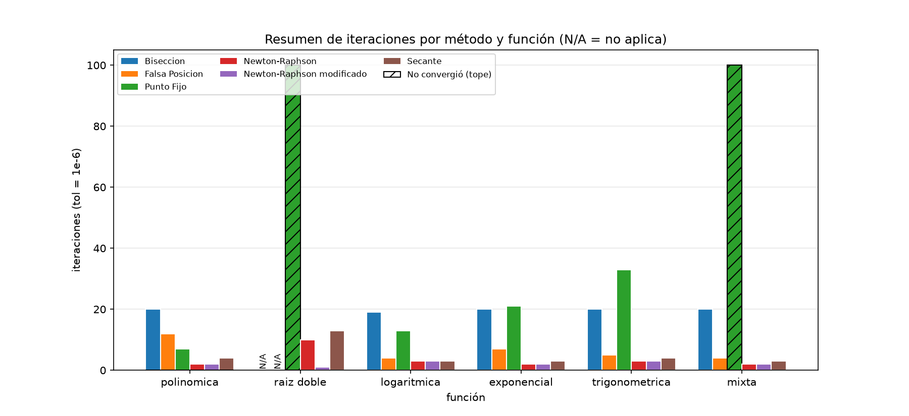

En todas las funciones con raíz simple, los más rápidos fueron **Newton-Raphson y Newton-Raphson modificado**, que necesitaron solo 2 o 3 iteraciones, una rapidez total impresionante. En la logarítmica, la secante los iba alcanzando de a poco, finalmente lo alcanzó con 3. En la raíz doble ganó claramente **Newton modificado**, que llegó a la raíz en una sola iteración, mientras que Newton normal necesitó 10.

La razón está en cuánta información usa cada método para dar el siguiente paso. Newton usa la derivada, o sea, la pendiente de la curva en el punto donde está, y con eso traza la tangente y salta casi directo a la raíz. Por eso su convergencia es cuadrática: en cada iteración la cantidad de cifras correctas aproximadamente se duplica. La secante hace algo ligeramente parecido, pero aproxima la pendiente con una recta entre dos puntos, así que es un poco más lentita , aunque tiene la ventaja de no necesitar la derivada.

En el otro extremo, bisección fue la más lenta, con 19 o 20 iteraciones en todas las funciones. No es porque no funcione por ejemplo, sino porque no mira la forma de la curva: solo parte el intervalo a la mitad una y otra vez. Por lo mismo, su número de iteraciones casi no cambia entre funciones y se puede predecir de antemano.

Punto fijo fue el más irregular: le fue bien en la polinómica, pero muy mal en la trigonométrica y no alcanzó a converger en la mixta. Su velocidad depende de qué tan buena sea la g(x) elegida, y no solo del método.

### 2. ¿Qué orden de convergencia tiene cada método y cómo se refleja en el gráfico |error| vs iteración?

Bisección, falsa posición y punto fijo son **lineales**: en los gráficos como la escala logaritmica se ven como líneas que bajan de forma pareja, con pendiente constante. Bisección además baja como en un zig-zag, porque a veces el punto medio queda más lejos de la raíz que el anterior.

La secante es **superlineal** porque la línea baja cada vez más rápido.

Newton y Newton modificado son **cuadráticos**: caen casi en vertical en las últimas iteraciones.

En punto fijo, la pendiente depende de |g'(raíz)|: mientras más cerca de 1, más plana la línea. Con 0.14 que fue la polinomica tardó 7 iteraciones, con 0.67 que fue trigonometrica fueron 33 y con 0.96 que fue la mixta directamente no llegó.
 
| Polinómica | Logarítmica | Exponencial |
|---|---|---|
| 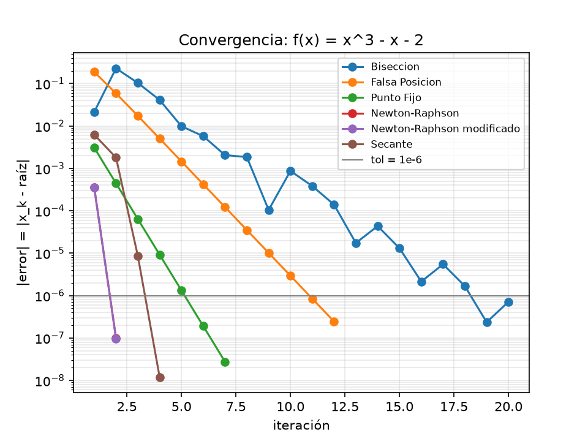 | 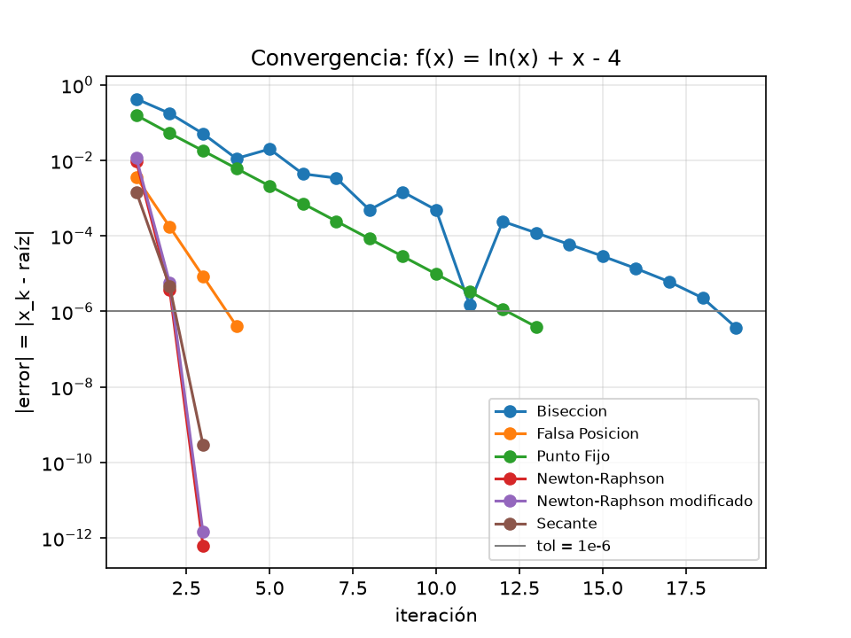 | 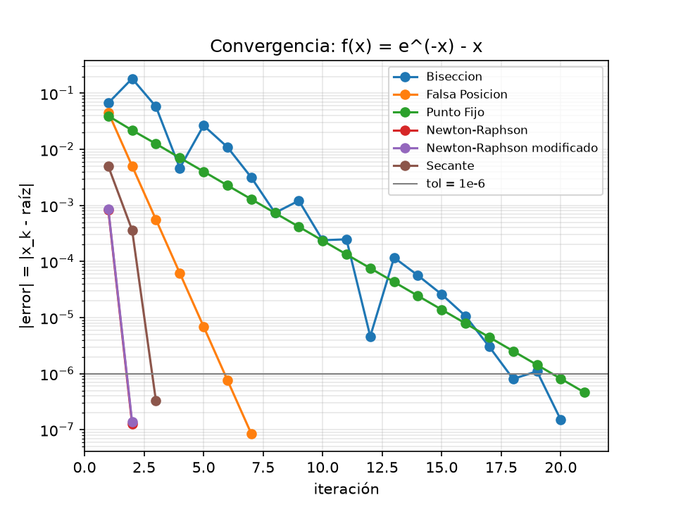 |
| **Trigonométrica** | **Mixta** | **Raíz doble** |
| 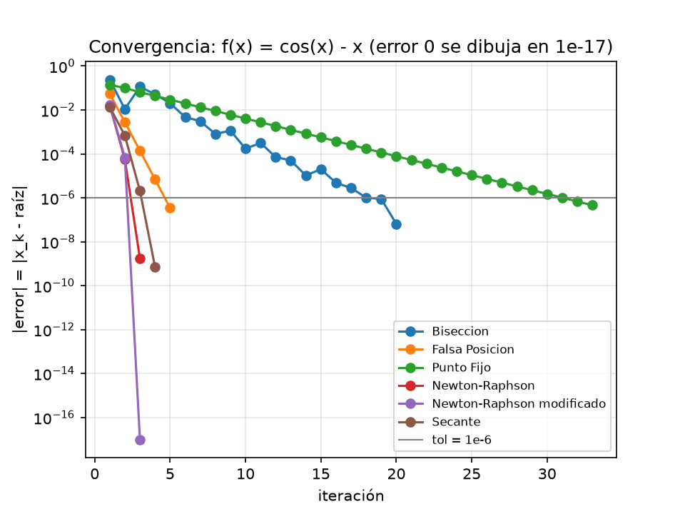 | 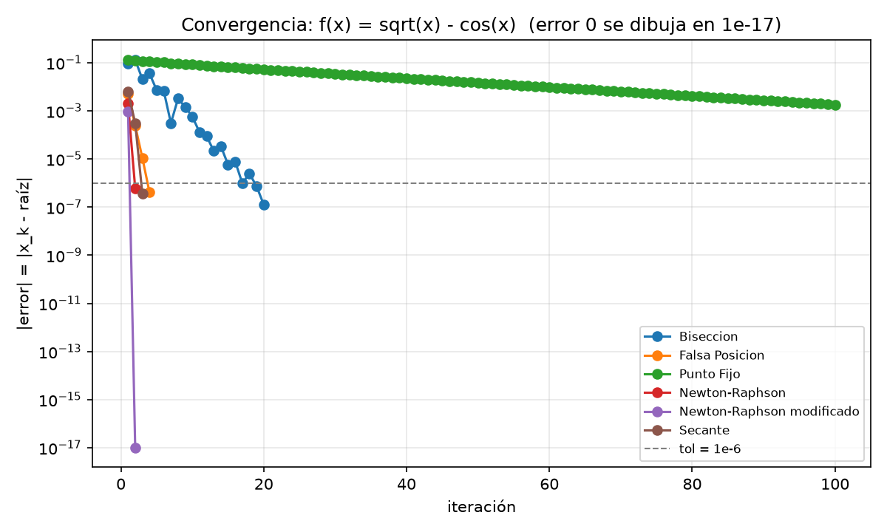 | 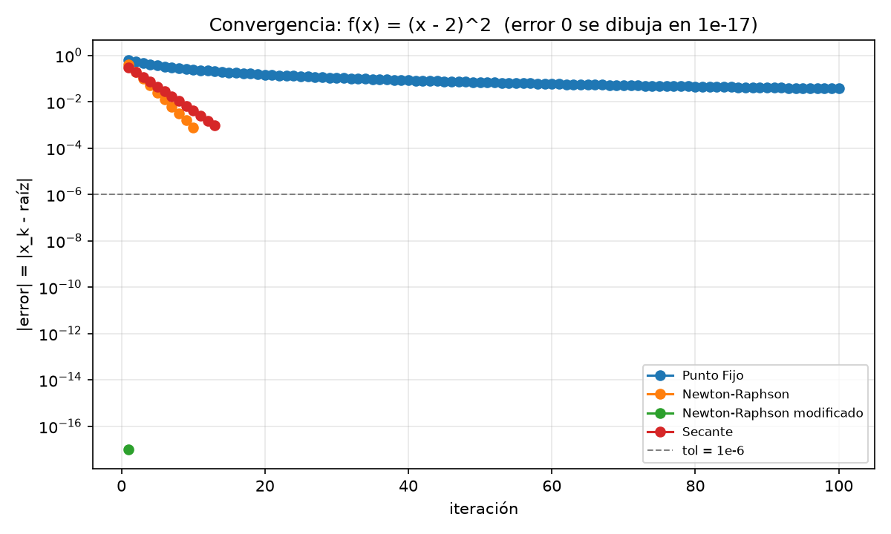 |

### 3. ¿Qué métodos requieren un intervalo con cambio de signo y cuáles no?

Bisección y falsa posición **sí necesitan** que la función cambie de signo en el intervalo, es decir, que en un extremo sea negativa y en el otro positiva (`f(a)·f(b) < 0`). Así saben que la raíz está "encerrada" entre a y b. Por eso no se pudieron usar en la raíz doble.

Punto fijo, secante, Newton y Newton modificado **no lo necesitan**, porque parten desde uno o dos puntos iniciales en vez de un intervalo. Lo malo claramente es que no siempre llegan a la raíz: punto fijo no lo logró en la raíz doble ni en la mixta.

| Polinómica | Logarítmica | Exponencial |
|---|---|---|
| 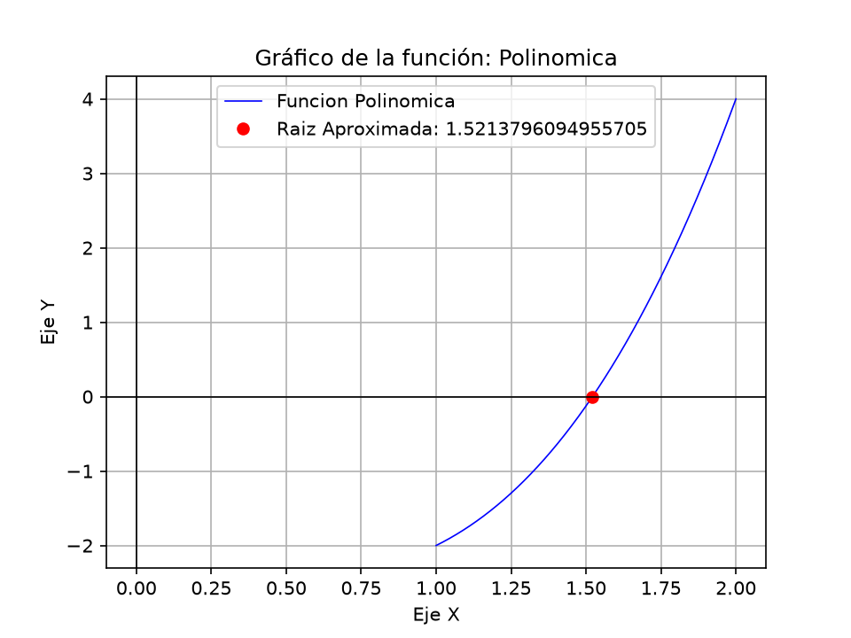 | 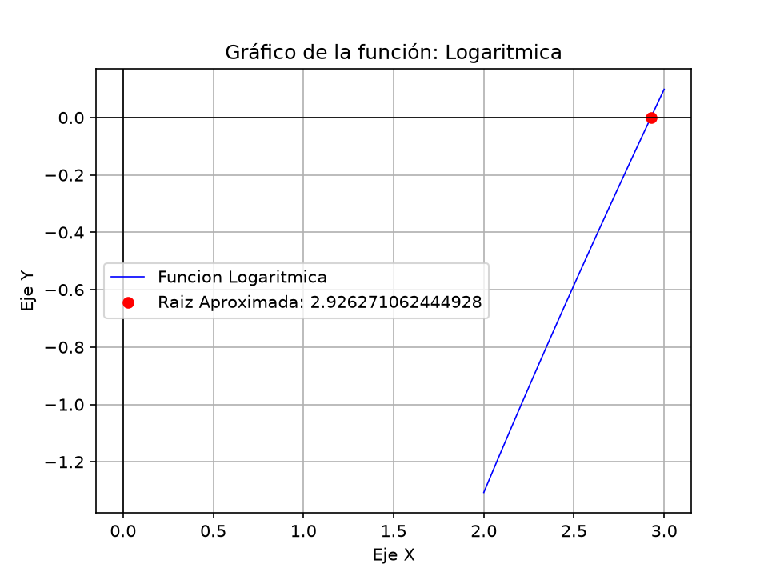 | 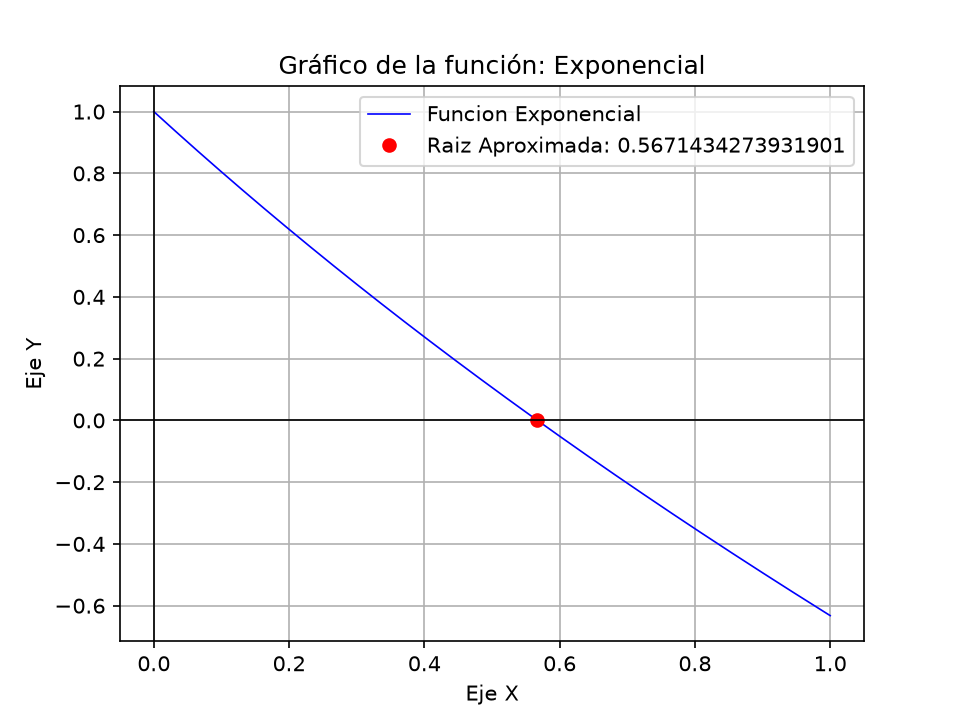 |
| **Trigonométrica** | **Mixta** | **Raíz doble** |
| 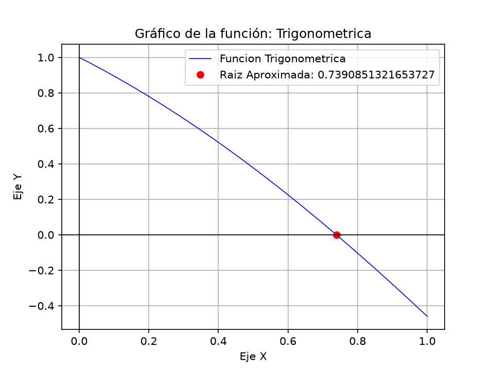 | 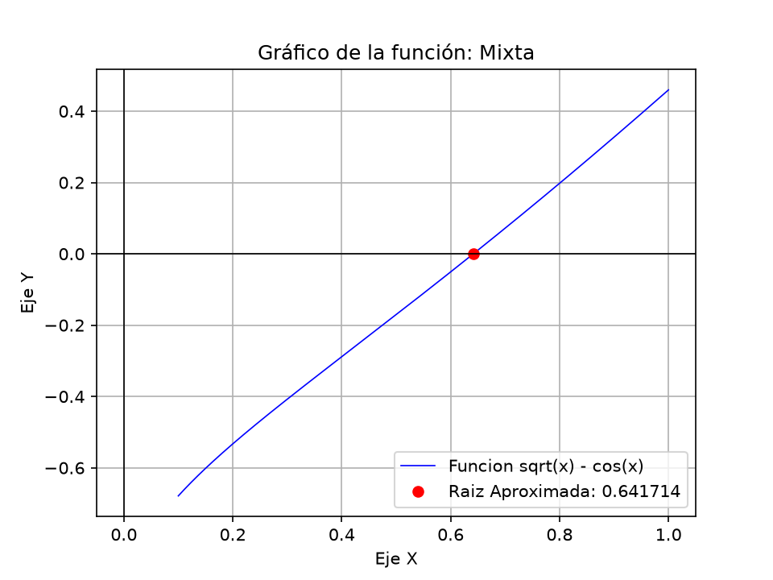 | 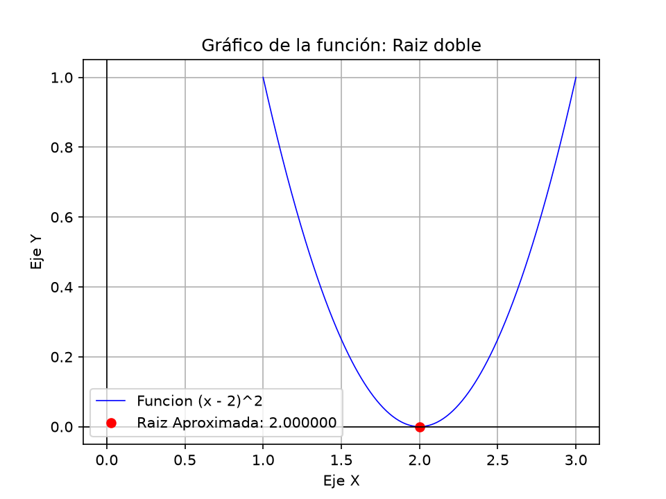 |

En los gráficos se ve la diferencia: las cinco primeras curvas atraviesan el eje x, pasando de un lado al otro. La raíz doble, en cambio, solo toca el eje en x = 2 y vuelve a subir, sin pasar nunca por debajo.

### 4. En la raíz doble: ¿qué métodos fallan o no aplican y cuál se comporta mejor? ¿Por qué?

La función (x − 2)² tiene su raíz en x = 2, pero ahí la curva solo toca el eje y vuelve a subir. Eso es un problema para todos los métodos:

| método | que fue lo que pasó| por qué ocurrió esto |
|---|---|---|
| Bisección y falsa posición | No fue posible usarlos | La función nunca es negativa, así que no hay cambio de signo |
| Punto fijo | No llegó a la raíz en las 100 iteraciones maximas que se podian | Su g(x) avanza cada vez más lento al acercarse a 2 |
| Newton | Llegó, pero lento porque fueron 10 iteraciones y es lento para el método | Cerca de la raíz la curva es casi plana, así que en cada paso solo avanza la mitad de lo que le falta |
| Secante | Llegó, pero lento tambien con 13 iteraciones | Le pasa lo mismo que a Newton |
| **Newton modificado** | **Llegó exacto en 1 iteración** | Usa también la segunda derivada, que es como que le avisara que la curva es plana y corrige el paso |

| Curva | Convergencia |
|---|---|
|  |  |

### 5. ¿Cómo influyen el intervalo inicial y la estimación inicial en las iteraciones y en la convergencia?

**En bisección**, lo único que importa es qué tan ancho es el intervalo: mientras más ancho, más veces hay que partirlo por la mitad. Pero el efecto es pequeño, porque cada iteración lo va reduciendo a la mitad. Se puede calcular de antemano con su formula `n = ⌈log₂((b − a)/tol)⌉`: para [1, 2] da 20 iteraciones, igual que nuestros resultados. Si hay cambio de signo, siempre encuentra la raíz.

**En Newton y secante** lo mas importante praacticamente es desde dónde se parte. Si el punto inicial está cerca de la raíz, llegan en 2 o 3 iteraciones. Si está lejos, o en una zona donde la curva es casi plana, pueden tardar muchasimo más o incluso no llegar nunca.

**En punto fijo**, importa más qué g(x) se elige que el punto de partida: con una buena g llega rápido desde casi cualquier lado, y con una mala g no llega, es relativo.

### 6. ¿Qué método recomiendan según el tipo de función (velocidad vs robustez)?

| tipo de funcion que tenemos que verificar | metodo que recomendamos | por qué |
|---|---| ---|
| Hay cambio de signo | Bisección | es lenta, pero nunca falla |
| Se tiene la derivada y un buen x₀ | Newton | es el mas rapido de 2 a 3 iteraciones|
| No se tiene información de la derivada | Secante | casi tan rapida como newton |
| Raíz múltiple | Newton modificado | el único que no se puso lento |

## Conclusión

